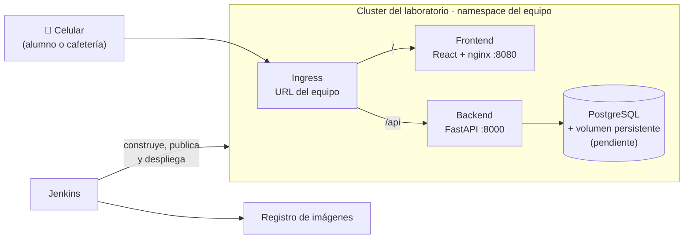
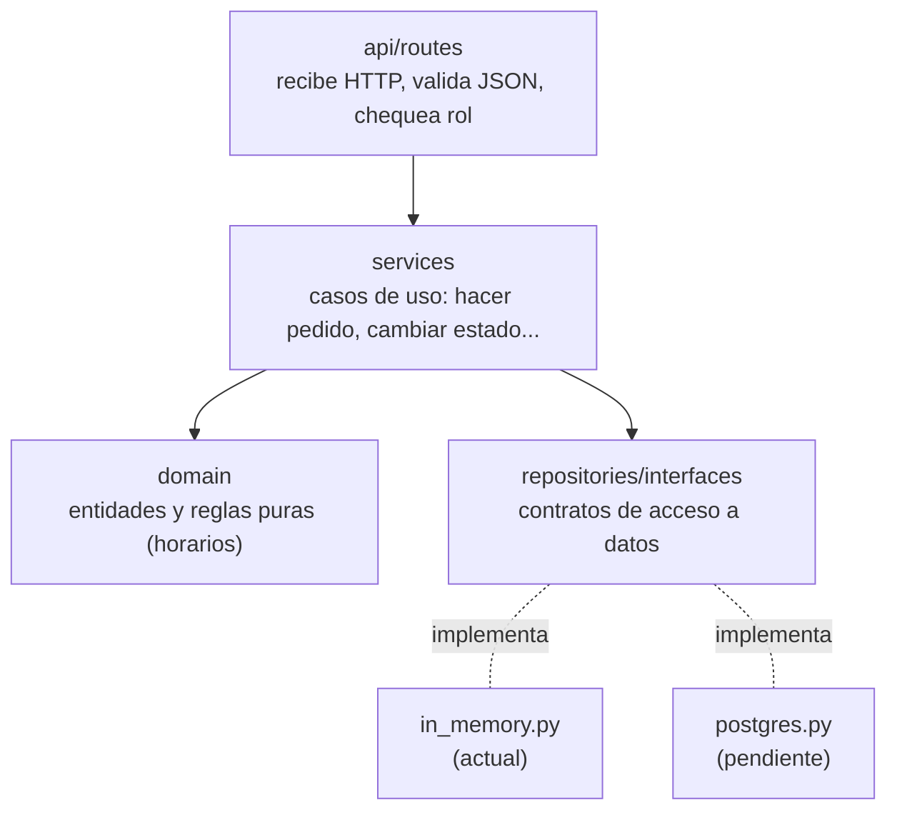
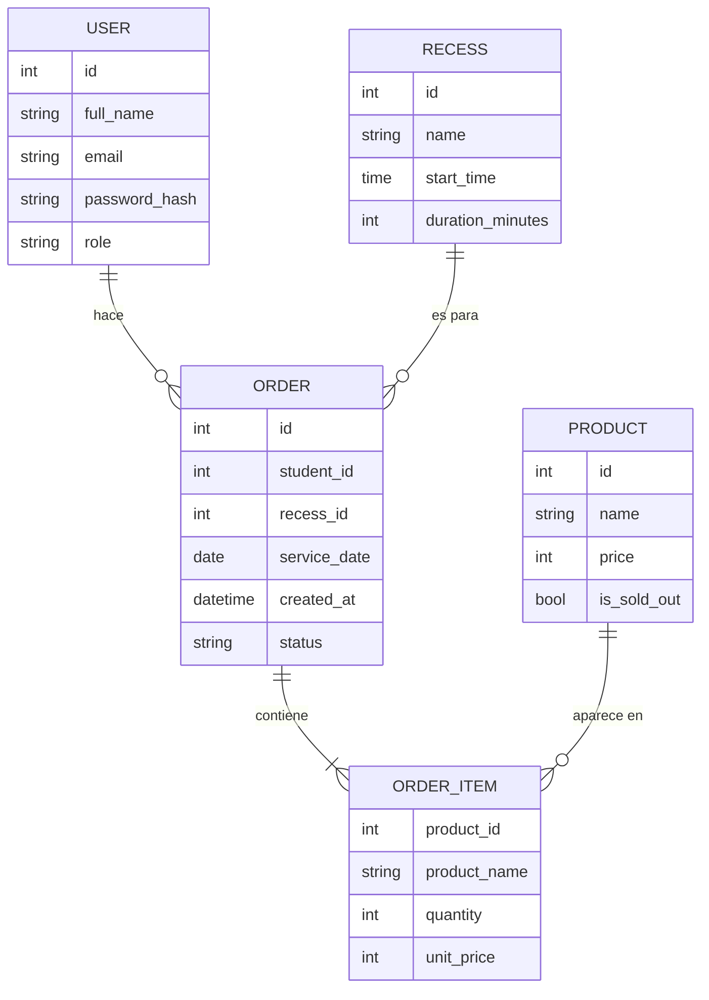
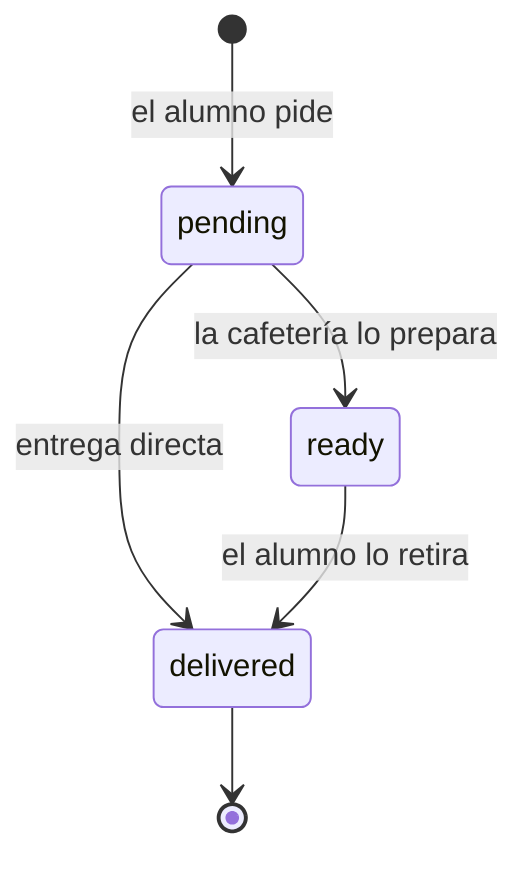

# Arquitectura · Cafetería

Este documento reúne todas las decisiones técnicas del proyecto: qué se construyó, cómo y por qué. Está pensado para que cualquier integrante pueda retomar el trabajo con todo el contexto.

**Índice**

1. [Contexto y requisitos](#1-contexto-y-requisitos)
2. [Vista general](#2-vista-general)
3. [Stack y por qué](#3-stack-y-por-qué)
4. [Estructura del repositorio](#4-estructura-del-repositorio)
5. [Capas del backend](#5-capas-del-backend)
6. [Modelo de dominio](#6-modelo-de-dominio)
7. [Manejo de horarios y zona horaria](#7-manejo-de-horarios-y-zona-horaria)
8. [La regla de la hora límite y la configuración de X](#8-la-regla-de-la-hora-límite-y-la-configuración-de-x)
9. [Autenticación y roles](#9-autenticación-y-roles)
10. [API](#10-api)
11. [Errores](#11-errores)
12. [Persistencia: repositorios y base de datos](#12-persistencia-repositorios-y-base-de-datos)
13. [Docker y entorno local](#13-docker-y-entorno-local)
    - [13 bis. Frontend](#13-bis-frontend)
14. [Pruebas](#14-pruebas)
15. [Despliegue en Kubernetes y Jenkins](#15-despliegue-en-kubernetes-y-jenkins)
16. [Convenciones de código](#16-convenciones-de-código)
17. [Limitaciones conocidas y decisiones abiertas](#17-limitaciones-conocidas-y-decisiones-abiertas)
18. [Próximos pasos](#18-próximos-pasos)

---

## 1. Contexto y requisitos

Proyecto 1 del Laboratorio de Kubernetes: **pedidos de la cafetería**. Los alumnos piden desde el celular antes del recreo y la cafetería tiene todo pronto a la hora del recreo.

### Requisitos del proyecto

| Tipo | Requisito |
|---|---|
| Roles | **Alumno**: hace y consulta sus pedidos. **Cafetería**: ve los pedidos agrupados por recreo y los marca como listos o entregados |
| MVP | Catálogo de productos con precio · recreos con hora de inicio · pedido con varios productos · estado del pedido · pantalla de la cafetería con lo pendiente del próximo recreo |
| Condición | Un pedido se acepta solo hasta **X minutos antes** del recreo |
| Condición | **X se cambia sin volver a desplegar** |
| Condición | Pasado el límite, la app no deja pedir **y lo dice claro** |
| Condición | **La regla la hace cumplir el backend**, no el frontend |
| Extras | Resumen de ventas del día · productos agotados |

### Requisitos generales del laboratorio

- Aplicación web usable desde el celular, con **frontend, backend con API y base de datos** (tres componentes como mínimo).
- **Datos persistentes**: si se reinicia la base, los datos siguen ahí.
- **Al menos dos roles** con acceso controlado (puede ser simple).
- Todo corriendo en el **namespace del equipo**, con una **URL propia** bajo el dominio del laboratorio.
- **Pipeline de Jenkins** que, ante un cambio en la rama principal, corre las pruebas, construye las imágenes, las publica en un registro y despliega sin tocar `kubectl` a mano.
- **Documento de arquitectura** (este) escrito antes de programar y actualizado al final con lo que de verdad se construyó.
- **Demo final**: la app funcionando en la URL pública, abierta desde un celular.

---

## 2. Vista general



- El **Ingress** manda todo lo que empieza con `/api` al backend y el resto al frontend. Así frontend y backend comparten dominio y no hay problemas de CORS en producción.
- El **backend** es el único que habla con la base de datos y el único que aplica las reglas de negocio.

---

## 3. Stack y por qué

| Pieza | Elección | Motivo |
|---|---|---|
| Lenguaje | **Python 3.12** | Poco código para lo que hace, fácil de leer para todo el equipo |
| Framework | **FastAPI** | Genera la documentación interactiva de la API sola (`/api/docs`), así quien hace el frontend puede probar todo sin esperar al backend. Valida los datos de entrada automáticamente |
| Validación | **Pydantic v2** | Viene con FastAPI; define el formato de entrada y salida de cada endpoint |
| Configuración | **pydantic-settings** | Lee variables de entorno con tipos y valores por defecto |
| Tokens | **PyJWT** | Liviano; solo se necesita firmar y verificar tokens |
| Contraseñas | **PBKDF2 de la librería estándar** (`hashlib`) | Seguro y sin dependencias extra |
| Zona horaria | **zoneinfo + tzdata** | `zoneinfo` es estándar; `tzdata` garantiza que exista `America/Montevideo` dentro de la imagen |
| Servidor | **Uvicorn** | El servidor ASGI recomendado para FastAPI |
| Pruebas | **pytest + TestClient** (httpx) | Pruebas de la API completa sin levantar un servidor |
| Frontend | **React 18 + Vite**, CSS propio | Pocas dependencias (solo `react`, `react-dom` y `react-router-dom`); Vite compila rápido en Jenkins. Sin framework de CSS: la estética es propia (sección 13 bis) |
| Servidor del frontend | **nginx** (`nginx-unprivileged`) | Sirve los archivos estáticos sin root y, fuera del cluster, manda `/api` al backend |
| Base de datos (pendiente) | **PostgreSQL 16** (propuesta) | Estándar, con buen soporte de tipos de fecha y hora con zona |

Se descartaron Node + Express (más armado manual de validación y documentación) y Java + Spring Boot (mucho código repetitivo, imagen pesada y compilación lenta en Jenkins).

---

## 4. Estructura del repositorio

```
cafeteria/
├── README.md                  ← presentación no técnica del proyecto
├── architecture.md            ← este documento
├── docker-compose.yml         ← entorno local
├── .gitignore
├── frontend/                  ← ver sección 13 bis
└── backend/
    ├── Dockerfile             ← etapas: base, test, runtime
    ├── .dockerignore
    ├── requirements.txt       ← dependencias de la app
    ├── requirements-dev.txt   ← dependencias de prueba
    ├── app/
    │   ├── main.py            ← create_app(): arma la aplicación
    │   ├── core/              ← piezas transversales
    │   │   ├── config.py      ← variables de entorno
    │   │   ├── clock.py       ← el reloj (SystemClock / FixedClock)
    │   │   └── security.py    ← hash de contraseñas y JWT
    │   ├── domain/            ← reglas puras, sin HTTP ni base de datos
    │   │   ├── models.py      ← entidades
    │   │   ├── schedule.py    ← cálculo de horarios y hora límite
    │   │   └── errors.py      ← errores de negocio
    │   ├── repositories/      ← acceso a datos
    │   │   ├── interfaces.py  ← contratos (clases abstractas)
    │   │   ├── in_memory.py   ← implementación en memoria (actual)
    │   │   ├── factory.py     ← elige la implementación según la config
    │   │   └── seed_data.py   ← datos de ejemplo
    │   ├── services/          ← casos de uso
    │   │   ├── auth_service.py
    │   │   ├── catalog_service.py
    │   │   ├── configuration_service.py
    │   │   ├── recess_schedule_service.py
    │   │   ├── order_service.py
    │   │   └── cafeteria_service.py
    │   └── api/               ← HTTP
    │       ├── dependencies.py    ← arma servicios, usuario actual, roles
    │       ├── schemas.py         ← formato JSON de entrada y salida
    │       ├── presenters.py      ← entidades → respuestas
    │       ├── error_handlers.py  ← errores de negocio → códigos HTTP
    │       └── routes/            ← un archivo por recurso
    └── tests/
        ├── conftest.py        ← app nueva por test, reloj fijo, usuarios
        ├── test_schedule.py
        ├── test_auth.py
        ├── test_orders.py
        └── test_cafeteria.py
```

La carpeta `k8s/` y el `Jenkinsfile` todavía no existen; se agregan en la raíz cuando se trabajen.

---

## 5. Capas del backend



| Capa | Responsabilidad | No hace |
|---|---|---|
| `api/routes` | Recibir el pedido HTTP, validar el JSON, verificar el rol, llamar a un servicio y dar forma a la respuesta | No tiene reglas de negocio ni accede a repositorios |
| `services` | Orquestar un caso de uso: buscar datos, aplicar reglas, guardar | No sabe nada de HTTP ni de SQL |
| `domain` | Entidades y cálculos puros (horarios, hora límite) | No lee la hora del sistema ni accede a datos |
| `repositories` | Guardar y leer datos | No aplica reglas de negocio |
| `core` | Configuración, reloj, seguridad | — |

**Cómo se conectan:** `main.py` crea una sola vez la configuración, los repositorios y el reloj, y los guarda en `app.state`. En cada pedido HTTP, `api/dependencies.py` toma esos objetos y construye los servicios que la ruta necesita (inyección de dependencias de FastAPI). Ninguna clase crea sus propias dependencias: todas las reciben por el constructor, y por eso se pueden reemplazar fácilmente en las pruebas.

---

## 6. Modelo de dominio

Los nombres del código están en inglés; los textos que ve el usuario, en español.

| Código | Significado |
|---|---|
| `Recess` | Recreo |
| `Order` / `OrderItem` | Pedido / línea del pedido |
| `Product` | Producto |
| `Role.STUDENT` / `Role.CAFETERIA` | Alumno / cafetería |
| `service_date` | Día del recreo para el que es el pedido |
| `order_cutoff_minutes` | X: minutos de anticipación |



Decisiones:

- **Precios en pesos enteros** (`int`). En Uruguay los precios de cafetería no usan centavos y así se evitan problemas de redondeo con decimales.
- **El ítem guarda una copia del nombre y del precio** al momento de pedir. Si después la cafetería cambia el precio, el pedido y el resumen de ventas siguen mostrando lo que realmente se cobró.
- **El total no se guarda**: se calcula sumando los ítems (`Order.total`).
- **Un recreo se repite todos los días** a la misma hora. No hay recreos por fecha.
- **El recreo tiene duración** (15 minutos por defecto, 30 para el almuerzo). El requisito solo pide hora de inicio, pero la duración hace falta para saber hasta cuándo mostrar un recreo en la pantalla de la cafetería (ver sección 7).
- **Estados del pedido** y cambios permitidos (solo hacia adelante):



- Las líneas repetidas del mismo producto se unen en una sola (2 medialunas + 1 medialuna = 3 medialunas).
- Máximo 20 unidades por producto en un pedido.

---

## 7. Manejo de horarios y zona horaria

Es la parte más delicada del proyecto, porque la regla principal depende de la hora.

### El problema

- Los contenedores corren en **UTC** por defecto. Si el código usa `datetime.now()` sin más, a las 09:00 de Montevideo el servidor cree que son las 12:00 y todos los cálculos se corren 3 horas.
- Si se mezclan fechas "naive" (sin zona) con fechas con zona, Python lanza un error o, peor, compara mal sin avisar.
- Las pruebas no pueden depender de la hora real: un test que pasa a las 9:00 fallaría a las 10:00.

### La solución

1. **Un único reloj** (`core/clock.py`). Nadie llama a `datetime.now()` directamente: todo el código pide la hora a un `Clock`.
   - `SystemClock` devuelve la hora real **siempre en la zona configurada** (`APP_TIMEZONE=America/Montevideo`), sin importar la zona del servidor.
   - `FixedClock` se usa en las pruebas: se detiene en un momento y se puede mover (`clock.move_to(...)`).
2. **La zona del liceo es explícita**. La lee `config.py` de la variable `APP_TIMEZONE`. Además, el Dockerfile define `TZ=America/Montevideo` solo para que los logs del contenedor muestren la hora local; el código **no depende** de esa variable.
3. **Los recreos guardan una hora de reloj de pared** (`09:30`, sin zona). Para comparar, se combina con la fecha y la zona del liceo y se obtiene un momento exacto:

   ```
   starts_at          = fecha + 09:30 en America/Montevideo  →  2026-10-20T09:30:00-03:00
   ordering_closes_at = starts_at − X minutos               →  2026-10-20T09:15:00-03:00
   ends_at            = starts_at + duración                 →  2026-10-20T09:45:00-03:00
   ```

4. **Todos los cálculos usan fechas con zona horaria.** Comparar dos momentos con zona es correcto aunque estén expresados en zonas distintas (las 12:14 UTC y las 09:14 de Montevideo son el mismo instante; hay una prueba para eso).
5. **Los cálculos son funciones puras** (`domain/schedule.py`): reciben la hora por parámetro, así que se prueban sin trucos.
6. **La API devuelve los momentos con su desfase** (`-03:00`), por ejemplo `"ordering_closes_at": "2026-10-20T09:15:00-03:00"`. El frontend no tiene que adivinar la zona.
7. `created_at` se guarda con zona horaria. En PostgreSQL tiene que ser una columna `timestamptz`.

Uruguay no tiene horario de verano desde 2015, pero como se usa `zoneinfo` con la zona real, si volviera a tenerlo el cálculo seguiría siendo correcto.

### Definiciones de negocio

| Concepto | Definición |
|---|---|
| ¿Para qué día es un pedido? | Siempre para **hoy** (`service_date = clock.today()`). No se puede pedir para mañana |
| ¿Hasta cuándo se puede pedir? | Mientras `ahora < ordering_closes_at`. Con recreo a las 09:30 y X = 15: a las 09:14:59 se acepta, desde las 09:15:00 no |
| "Próximo recreo" (pantalla de la cafetería) | El primer recreo de hoy **que todavía no terminó** (`ahora < ends_at`). Se usa el final y no el inicio para que, mientras la cafetería entrega los pedidos durante el recreo, la pantalla no salte al siguiente |
| ¿Y después del último recreo? | No hay próximo recreo; la pantalla muestra "No quedan recreos por hoy." |

---

## 8. La regla de la hora límite y la configuración de X

### Dónde vive X

En la tabla **`configuracion`** (clave → valor), con la clave `order_cutoff_minutes`.

- La cafetería la cambia con `PUT /api/configuration/order-cutoff` (rango permitido: 0 a 240 minutos).
- **Se lee de la base en cada uso**, no se guarda en memoria. Por eso el cambio aplica desde el siguiente pedido, sin reiniciar ni desplegar.
- Si la tabla todavía no tiene el valor, se usa `DEFAULT_ORDER_CUTOFF_MINUTES` (variable de entorno, 15 por defecto).

Por qué no un ConfigMap de Kubernetes: si X fuera una variable de entorno, cambiarla obliga a reiniciar los pods, y eso no cumple "sin volver a desplegar". Además, la cafetería no tiene acceso al cluster.

### Dónde se aplica la regla

En `OrderService.place_order` (`services/order_service.py`), en este orden:

1. Validar cantidades (al menos un producto, cantidades positivas, máximo 20 por producto).
2. Verificar que el recreo existe → si no, **404**.
3. Verificar que todavía se puede pedir → si no, **422** con `code = "ORDERING_CLOSED"` y el mensaje: *"Ya no se puede pedir para el primer recreo de las 09:30. Los pedidos cerraron a las 09:15."*
4. Verificar que cada producto existe (404) y no está agotado (409, `PRODUCT_SOLD_OUT`).
5. Guardar el pedido con la copia del precio de cada producto.

El frontend puede usar `GET /api/recesses/today` (campo `is_accepting_orders` y `ordering_closes_at`) para deshabilitar el botón y mostrar la hora de cierre, pero **la decisión final siempre es del backend**: un pedido fuera de hora enviado directo a la API se rechaza igual.

---

## 9. Autenticación y roles

- **Login** con correo y contraseña: `POST /api/auth/login` devuelve un **JWT** (válido 8 horas, configurable) y los datos del usuario.
- El token se manda en cada pedido con el encabezado `Authorization: Bearer <token>`.
- El token lleva el id del usuario (`sub`) y el rol. En cada pedido el backend busca al usuario por id, así que si se borra un usuario su token deja de servir.
- **No hay registro**: los usuarios se cargan con los datos de ejemplo (`repositories/seed_data.py`). El requisito pide "acceso simple, pero que exista".
- Las contraseñas se guardan con PBKDF2-SHA256 (200.000 iteraciones y salt aleatorio), en el formato `iteraciones$salt$hash`.
- Si el correo no existe o la contraseña está mal, el mensaje es el mismo, para no revelar qué correos están registrados.

Control por rol, en `api/dependencies.py`:

| Dependencia | Uso |
|---|---|
| `get_current_user` | Cualquier usuario con sesión iniciada |
| `require_student` | Solo alumnos (hacer pedidos, ver los propios) |
| `require_cafeteria` | Solo la cafetería (pantalla, estados, configuración, catálogo) |

Usuarios de prueba:

| Correo | Contraseña | Rol |
|---|---|---|
| alumno1@cafeteria.test | alumno123 | Alumno (Lucía Fernández) |
| alumno2@cafeteria.test | alumno123 | Alumno (Martín Rodríguez) |
| cafeteria@cafeteria.test | cafeteria123 | Cafetería |

---

## 10. API

Documentación interactiva: **`/api/docs`**. Esquema OpenAPI: `/api/openapi.json`.

Todas las rutas, salvo `/health`, viven bajo el prefijo **`/api`**.

| Método | Ruta | Quién | Qué hace |
|---|---|---|---|
| GET | `/health` | Público | Chequeo de salud (probes de Kubernetes) |
| POST | `/api/auth/login` | Público | Inicia sesión y devuelve el token |
| GET | `/api/auth/me` | Con sesión | Datos del usuario actual |
| GET | `/api/products` | Con sesión | Catálogo |
| POST | `/api/products` | Cafetería | Crear producto |
| PATCH | `/api/products/{id}` | Cafetería | Cambiar nombre, precio o marcar agotado (`{"is_sold_out": true}`) |
| GET | `/api/recesses` | Con sesión | Recreos configurados |
| GET | `/api/recesses/today` | Con sesión | Recreos de hoy con hora de cierre y si aceptan pedidos |
| POST | `/api/recesses` | Cafetería | Crear recreo |
| PATCH | `/api/recesses/{id}` | Cafetería | Cambiar nombre, hora o duración |
| POST | `/api/orders` | Alumno | Hacer un pedido (aplica la hora límite) |
| GET | `/api/orders/mine` | Alumno | Mis pedidos, del más nuevo al más viejo |
| GET | `/api/orders/{id}` | Dueño o cafetería | Un pedido |
| PATCH | `/api/orders/{id}/status` | Cafetería | Cambiar estado a `ready` o `delivered` |
| GET | `/api/cafeteria/next-recess` | Cafetería | Pantalla principal: lo que falta entregar del próximo recreo y cuánto preparar de cada producto |
| GET | `/api/cafeteria/orders-today` | Cafetería | Todos los pedidos de hoy agrupados por recreo |
| GET | `/api/cafeteria/sales-summary?service_date=AAAA-MM-DD` | Cafetería | Resumen de ventas (por defecto, hoy) |
| GET | `/api/configuration` | Con sesión | Valor actual de X |
| PUT | `/api/configuration/order-cutoff` | Cafetería | Cambiar X |

### Ejemplo: hacer un pedido

```http
POST /api/orders
Authorization: Bearer <token>

{ "recess_id": 1, "items": [ { "product_id": 1, "quantity": 2 }, { "product_id": 5, "quantity": 1 } ] }
```

Respuesta `201`:

```json
{
  "id": 1,
  "status": "pending",
  "recess_id": 1,
  "recess_name": "Primer recreo",
  "recess_start_time": "09:30:00",
  "service_date": "2026-10-20",
  "created_at": "2026-10-20T09:05:12-03:00",
  "items": [
    { "product_id": 1, "product_name": "Medialuna", "quantity": 2, "unit_price": 35, "subtotal": 70 },
    { "product_id": 5, "product_name": "Café", "quantity": 1, "unit_price": 60, "subtotal": 60 }
  ],
  "total": 130
}
```

Fuera de hora, respuesta `422`:

```json
{ "code": "ORDERING_CLOSED", "detail": "Ya no se puede pedir para el primer recreo de las 09:30. Los pedidos cerraron a las 09:15." }
```

### Convenciones de formato

- `start_time` es una hora de reloj del liceo: `"09:30:00"`.
- Los campos que terminan en `_at` son momentos exactos con desfase: `"2026-10-20T09:15:00-03:00"`.
- `service_date` es una fecha: `"2026-10-20"`.
- Los precios y totales son enteros, en pesos uruguayos.

---

## 11. Errores

Los servicios lanzan errores de negocio (`domain/errors.py`) con un mensaje en español listo para mostrar. `api/error_handlers.py` los traduce a HTTP. **Toda respuesta de error tiene la misma forma:**

```json
{ "code": "CODIGO_FIJO", "detail": "Mensaje para el usuario." }
```

El frontend decide qué hacer según `code` (fijo) y muestra `detail` (texto).

| Error | `code` | HTTP |
|---|---|---|
| `NotFoundError` | `NOT_FOUND` | 404 |
| `InvalidCredentialsError` | `INVALID_CREDENTIALS` | 401 |
| `PermissionDeniedError` | `PERMISSION_DENIED` | 403 |
| `InvalidDataError` | `INVALID_DATA` | 422 |
| `InvalidOrderError` | `INVALID_ORDER` | 422 |
| `OrderingClosedError` | `ORDERING_CLOSED` | 422 |
| `ProductSoldOutError` | `PRODUCT_SOLD_OUT` | 409 |
| `InvalidStatusChangeError` | `INVALID_STATUS_CHANGE` | 409 |
| `InvalidSettingError` | `INVALID_SETTING` | 422 |

Los errores de validación del JSON (un campo que falta, un tipo incorrecto) los genera FastAPI con su formato estándar, también con código 422.

---

## 12. Persistencia: repositorios y base de datos

### Situación actual

El backend usa **repositorios en memoria** (`repositories/in_memory.py`). Sirven para desarrollar y probar, pero:

- **los datos se pierden al reiniciar** el contenedor;
- **no funcionan con más de una réplica** (cada pod tendría sus propios datos).

O sea, todavía **no cumplen el requisito de persistencia**. Falta la implementación con PostgreSQL.

### El contrato

`repositories/interfaces.py` define una clase abstracta por entidad. Los servicios solo conocen estas interfaces. La implementación con base de datos tiene que respetar exactamente los mismos métodos y estas reglas:

- `add(entity)` recibe una entidad con `id = None`, la guarda, le asigna el id generado y la devuelve.
- `update(entity)` guarda los cambios de una entidad existente.
- `get_by_...` devuelve `None` si no encuentra nada (no lanza error).
- Los `list_...` devuelven listas (vacías si no hay resultados) con el orden que indica cada método:
  - `ProductRepository.list_all` → por nombre
  - `RecessRepository.list_all` → por hora de inicio
  - `OrderRepository.list_by_student` → del más nuevo al más viejo
  - `OrderRepository.list_by_service_date` → del más viejo al más nuevo
- `OrderRepository.add` guarda el pedido **y sus líneas en una misma transacción**: o se guarda todo, o nada.
- `OrderRepository.get_by_id` y los `list_...` devuelven los pedidos **con sus líneas cargadas**.
- `UserRepository.get_by_email` no distingue mayúsculas de minúsculas.
- `SettingsRepository.set_value` crea la clave si no existe o la actualiza si existe (upsert).

| Interfaz | Métodos |
|---|---|
| `UserRepository` | `add`, `get_by_id`, `get_by_email` |
| `ProductRepository` | `add`, `update`, `get_by_id`, `list_all` |
| `RecessRepository` | `add`, `update`, `get_by_id`, `list_all` |
| `OrderRepository` | `add`, `update`, `get_by_id`, `list_by_student`, `list_by_service_date` |
| `SettingsRepository` | `get_value`, `set_value` |

### Esquema propuesto para PostgreSQL

Los nombres de las tablas siguen lo acordado en el equipo (en español). Las columnas usan los mismos nombres que los atributos de las entidades, así el mapeo es directo.

```sql
CREATE TABLE usuarios (
    id             SERIAL PRIMARY KEY,
    full_name      TEXT NOT NULL,
    email          TEXT NOT NULL UNIQUE,
    password_hash  TEXT NOT NULL,
    role           TEXT NOT NULL CHECK (role IN ('student', 'cafeteria'))
);
CREATE UNIQUE INDEX usuarios_email_lower ON usuarios (lower(email));

CREATE TABLE productos (
    id           SERIAL PRIMARY KEY,
    name         TEXT NOT NULL,
    price        INTEGER NOT NULL CHECK (price > 0),
    is_sold_out  BOOLEAN NOT NULL DEFAULT FALSE
);

CREATE TABLE recreos (
    id                SERIAL PRIMARY KEY,
    name              TEXT NOT NULL,
    start_time        TIME NOT NULL,                      -- hora local del liceo, sin zona
    duration_minutes  INTEGER NOT NULL DEFAULT 15 CHECK (duration_minutes > 0)
);

CREATE TABLE configuracion (
    clave  TEXT PRIMARY KEY,
    valor  TEXT NOT NULL
);

CREATE TABLE pedidos (
    id            SERIAL PRIMARY KEY,
    student_id    INTEGER NOT NULL REFERENCES usuarios (id),
    recess_id     INTEGER NOT NULL REFERENCES recreos (id),
    service_date  DATE NOT NULL,
    created_at    TIMESTAMPTZ NOT NULL,                   -- con zona horaria
    status        TEXT NOT NULL CHECK (status IN ('pending', 'ready', 'delivered'))
);
CREATE INDEX pedidos_por_dia_y_recreo ON pedidos (service_date, recess_id);
CREATE INDEX pedidos_por_alumno       ON pedidos (student_id, created_at DESC);

CREATE TABLE pedido_items (
    id            SERIAL PRIMARY KEY,
    pedido_id     INTEGER NOT NULL REFERENCES pedidos (id) ON DELETE CASCADE,
    product_id    INTEGER NOT NULL REFERENCES productos (id),
    product_name  TEXT NOT NULL,                          -- copia al momento de pedir
    quantity      INTEGER NOT NULL CHECK (quantity > 0),
    unit_price    INTEGER NOT NULL CHECK (unit_price > 0) -- copia al momento de pedir
);
```

Puntos de atención:

- `created_at` tiene que ser `TIMESTAMPTZ`, no `TIMESTAMP`, para no perder la zona horaria.
- `start_time` es `TIME` sin zona, a propósito: es la hora de reloj del liceo (ver sección 7).
- Los enums (`role`, `status`) se guardan como texto con su `.value` (`"student"`, `"pending"`...) y se convierten de vuelta con `Role(valor)` y `OrderStatus(valor)`.

### Pasos para conectar la base

1. Agregar las dependencias a `requirements.txt` (propuesta: `SQLAlchemy` 2.x, `psycopg[binary]` 3.x y `alembic` para las migraciones).
2. Crear `app/repositories/postgres.py` con una clase por interfaz (`PostgresUserRepository`, etc.) y una función `build_postgres_repositories(database_url) -> Repositories`, igual que `build_in_memory_repositories`.
3. Agregar la rama `"postgres"` en `app/repositories/factory.py` (ya está marcado el lugar).
4. Crear las tablas con migraciones de Alembic y correrlas al iniciar el contenedor, antes de levantar uvicorn.
5. Agregar el servicio `db` (imagen `postgres:16`, con un volumen con nombre para que los datos persistan) en `docker-compose.yml`, y en el servicio `backend` las variables `REPOSITORY_BACKEND=postgres` y `DATABASE_URL=postgresql+psycopg://usuario:clave@db:5432/cafeteria`, más un `depends_on` con `condition: service_healthy`.
6. `seed_demo_data` ya funciona con cualquier implementación (solo usa las interfaces y no hace nada si ya hay productos), así que la base nueva se carga sola con los datos de ejemplo.
7. Correr las pruebas. Idealmente, sumar pruebas que ejecuten los mismos casos contra la base real.

No hace falta tocar servicios, rutas ni reglas.

---

## 13. Docker y entorno local

Requisito: solo **Docker** y **Docker Compose**. No hace falta instalar Python.

### Dockerfile (`backend/Dockerfile`)

Imagen base `python:3.12-slim`, con tres etapas:

| Etapa | Contenido | Uso |
|---|---|---|
| `base` | Python + `requirements.txt` | Común a las otras dos |
| `test` | `base` + `requirements-dev.txt` + código + tests; corre `pytest -v` | `docker build --target test` en la pipeline |
| `runtime` | `base` + código, **usuario sin privilegios** (`appuser`, uid 10001), puerto 8000, `uvicorn` | La imagen que se despliega |

Así las herramientas de prueba no quedan en la imagen de producción, y el contenedor nunca corre como root.

### docker-compose.yml

| Servicio | Qué hace |
|---|---|
| `backend` | Construye la etapa `runtime`, expone `localhost:8000` y tiene un healthcheck contra `/health` |
| `frontend` | Construye la imagen del frontend, expone `localhost:8080` y manda `/api` al servicio `backend` |
| `backend-tests` | Perfil `test`. Construye la etapa `test` y corre las pruebas |

```bash
docker compose up --build                              # levanta la app (:8080) y la API (:8000)
docker compose --profile test run --rm backend-tests   # corre las pruebas
docker compose down                                    # apaga todo
```

### Variables de entorno

| Variable | Por defecto | Para qué |
|---|---|---|
| `APP_TIMEZONE` | `America/Montevideo` | Zona horaria del liceo |
| `REPOSITORY_BACKEND` | `memory` | `memory` o, cuando exista, `postgres` |
| `DATABASE_URL` | vacío | Conexión a PostgreSQL |
| `JWT_SECRET` | valor de desarrollo | Clave para firmar tokens. **En el cluster tiene que venir de un Secret** |
| `ACCESS_TOKEN_EXPIRATION_MINUTES` | `480` | Duración de la sesión |
| `DEFAULT_ORDER_CUTOFF_MINUTES` | `15` | X inicial, si la tabla `configuracion` no lo tiene |
| `CORS_ALLOWED_ORIGINS` | `*` | Orígenes permitidos, separados por coma |

---

## 13 bis. Frontend

### Estructura

```
frontend/
├── Dockerfile               ← etapas: build (Node) y runtime (nginx)
├── nginx.conf.template      ← sirve la app y manda /api al backend
├── vite.config.js           ← en desarrollo, /api va a localhost:8000
└── src/
    ├── main.jsx / App.jsx   ← rutas según el rol del usuario
    ├── api.js               ← única puerta a la API; errores como ApiError {code, detail}
    ├── session.jsx          ← usuario actual y token (localStorage)
    ├── hooks.js             ← useApiData (carga y refresco) y useNow (reloj)
    ├── format.js            ← horas en America/Montevideo, pesos, estados
    ├── styles.css           ← todos los estilos, con variables en :root
    ├── components/          ← AppShell, OrderTicket, Stepper, Notice...
    └── pages/
        ├── LoginPage.jsx
        ├── student/         ← OrderPage (pedir), MyOrdersPage
        └── cafeteria/       ← BoardPage, TodayPage, SalesPage, SettingsPage
```

### Pantallas

| Rol | Ruta | Qué hace | Endpoints |
|---|---|---|---|
| Ambos | `/` | Login | `POST /auth/login`, `GET /auth/me` |
| Alumno | `/pedir` | Elegir recreo de hoy, elegir productos y confirmar | `GET /recesses/today`, `GET /products`, `POST /orders` |
| Alumno | `/mis-pedidos` | Pedidos con su estado; se refresca cada 15 s | `GET /orders/mine` |
| Cafetería | `/cafeteria` | Tablero del próximo recreo: totales a preparar y pedidos; se refresca cada 5 s | `GET /cafeteria/next-recess`, `PATCH /orders/{id}/status` |
| Cafetería | `/cafeteria/hoy` | Todos los pedidos del día por recreo | `GET /cafeteria/orders-today` |
| Cafetería | `/cafeteria/ventas` | Resumen de ventas de un día | `GET /cafeteria/sales-summary` |
| Cafetería | `/cafeteria/ajustes` | Cambiar X, editar productos (precio, agotado) y recreos | `PUT /configuration/order-cutoff`, `PATCH/POST /products`, `PATCH/POST /recesses` |

### Decisiones

- **La regla de la hora límite la sigue aplicando el backend.** La pantalla deshabilita los recreos cerrados (con `is_accepting_orders` y `ordering_closes_at`) solo para ayudar. Si igual llega un `ORDERING_CLOSED`, se muestra el `detail` del backend y se recargan los recreos.
- **Las horas se muestran siempre en la zona del liceo** (`Intl.DateTimeFormat` con `timeZone: "America/Montevideo"`), aunque el celular esté en otra zona.
- **Refresco por polling** (`useApiData` con `refreshEverySeconds`) y no WebSockets: alcanza para el volumen de un liceo y no agrega nada al backend.
- **Misma URL para frontend y API.** El cliente siempre llama a `/api/...` relativo: en desarrollo lo resuelve el proxy de Vite, en docker compose nginx, y en el cluster el Ingress. No hace falta CORS ni configurar la URL del backend al compilar.
- **Usuarios de prueba en el login** solo en `npm run dev` (`import.meta.env.DEV`), nunca en la imagen publicada.
- **Si el token vence** (401), la sesión se cierra sola y vuelve al login.

### Estética

Una hoja de cuaderno: fondo cuadriculado, tinta de birome azul (`--ink`), resaltador amarillo (`<mark>`) en el dato importante (hasta qué hora se puede pedir) y lapicera roja para tachar los recreos que ya cerraron y los productos agotados. Los pedidos se muestran como tickets de cantina con el borde dentado. Tipografías: *Archivo* (títulos), *Atkinson Hyperlegible* (texto, pensada para leerse bien) y *Spline Sans Mono* (horas y precios). Todo el diseño sale de las variables de `:root` en `styles.css`.

Pensada primero para el celular: las pestañas del alumno van abajo, al alcance del pulgar, y la barra del carrito queda fija arriba de ellas. La cafetería usa la misma app en una pantalla grande, con los totales a preparar en números grandes.

### Desarrollo

```bash
docker compose up -d backend    # la API en :8000
cd frontend && npm install && npm run dev   # la app en http://localhost:5173
```

### Imagen

| Etapa | Contenido |
|---|---|
| `build` | `node:20-alpine`, `npm ci` y `npm run build`. Si no compila, la pipeline se corta acá |
| `runtime` | `nginxinc/nginx-unprivileged`, puerto **8080**, sin root. La variable `BACKEND_URL` (por defecto `http://backend:8000`) dice a dónde mandar `/api` |

---

## 14. Pruebas

31 pruebas con `pytest`, en `backend/tests/`. Corren en menos de dos segundos.

- **Cada prueba recibe una app nueva** (`create_app(...)`) con repositorios en memoria limpios y los datos de ejemplo.
- **El reloj está detenido** (`FixedClock`) el 20/10/2026 a las 09:00 de Montevideo, y cada prueba lo mueve a la hora que necesita. Las pruebas nunca dependen de la hora real.

| Archivo | Qué cubre |
|---|---|
| `test_schedule.py` | Cálculo de horarios: hora de cierre, el límite exacto (09:14:59 sí, 09:15:00 no), comparación con momentos en UTC, próximo recreo durante y después de un recreo |
| `test_orders.py` | Pedido antes y después del cierre, mensaje claro, cambio de X que aplica en el momento, productos agotados o inexistentes, unión de líneas repetidas, precio copiado, permisos |
| `test_cafeteria.py` | Pantalla del próximo recreo, totales a preparar, cambios de estado (y que no vuelvan atrás), agrupación por recreo, resumen de ventas |
| `test_auth.py` | Login correcto e incorrecto, rutas que exigen sesión, control de rol |

---

## 15. Despliegue en Kubernetes y Jenkins

Pendiente. Lineamientos para cuando se arme:

**Kubernetes (carpeta `k8s/`)**

- `Deployment` del backend con la imagen `runtime`, el puerto 8000 y probes de *liveness* y *readiness* contra `GET /health`.
- `ConfigMap` con `APP_TIMEZONE`, `REPOSITORY_BACKEND`, `DEFAULT_ORDER_CUTOFF_MINUTES` y `CORS_ALLOWED_ORIGINS`.
- `Secret` con `JWT_SECRET` y `DATABASE_URL`.
- `Service` del backend (puerto 8000).
- `Deployment` y `Service` del frontend con la imagen `runtime` de `frontend/`, puerto 8080, y `BACKEND_URL` apuntando al Service del backend.
- `Ingress` con la URL del equipo: `/api` → backend, `/` → frontend.
- PostgreSQL con un `StatefulSet` (o `Deployment` de una réplica) y un `PersistentVolumeClaim`, para cumplir "si se reinicia la base, los datos siguen ahí".
- Mientras el backend use repositorios en memoria, tiene que correr con **una sola réplica**.

**Jenkins (`Jenkinsfile` en la raíz)**, ante un cambio en la rama principal:

1. **Test**: `docker build --target test -t cafeteria-backend-test backend/` y luego `docker run --rm cafeteria-backend-test`. Si falla, la pipeline se corta.
2. **Build**: `docker build --target runtime -t <registro>/cafeteria-backend:<commit> backend/` y `docker build -t <registro>/cafeteria-frontend:<commit> frontend/`.
3. **Push**: publicar la imagen en el registro del laboratorio.
4. **Deploy**: aplicar los manifiestos y actualizar la imagen del Deployment desde Jenkins, con las credenciales del cluster guardadas en Jenkins. Nadie corre `kubectl` a mano.

Etiquetar las imágenes con el hash del commit (y no solo con `latest`) para que Kubernetes detecte la versión nueva y para poder volver atrás.

---

## 16. Convenciones de código

La prioridad es la **legibilidad**.

- **Nombres claros y completos**: `ordering_closes_at`, `quantities_by_product`, `require_cafeteria`. Nada de abreviaturas como `qty`, `tmp` o `res`.
- **Código en inglés, textos para el usuario en español.** Los comentarios y docstrings, en español.
- **Espacio para respirar**: líneas en blanco entre bloques lógicos y separadores (`# ----`) entre secciones de un archivo.
- **Una responsabilidad por capa** (sección 5): las rutas no tienen reglas, los servicios no saben de HTTP, el dominio no lee la hora ni accede a datos.
- **Dependencias por constructor**: ninguna clase crea sus propios repositorios, servicios o reloj.
- **Nunca `datetime.now()`**: siempre `clock.now()`.
- **Funciones cortas** con un nombre que diga qué hacen; si un paso necesita un comentario para entenderse, conviene extraerlo a una función con buen nombre.
- **Los errores de negocio** se lanzan como subclases de `DomainError`, con un mensaje para el usuario. No se lanzan `HTTPException` desde los servicios.
- **Cada regla nueva viene con su prueba.**

---

## 17. Limitaciones conocidas y decisiones abiertas

| Tema | Situación actual | Posible mejora |
|---|---|---|
| Persistencia | En memoria; se pierde al reiniciar | Implementar PostgreSQL (sección 12) |
| Pedidos para otro día | Solo para hoy | Permitir elegir fecha si el equipo lo decide |
| Fines de semana y feriados | Los recreos existen todos los días | Agregar días de la semana a cada recreo o un calendario de feriados |
| Cancelar un pedido | No existe | Estado `cancelled`, permitido solo antes del cierre |
| Registro de usuarios | No existe; usuarios cargados de antemano | Alcanza para el requisito |
| Contraseñas y secreto de prueba | Valores conocidos en el código y el compose | Cambiar antes de la demo pública; `JWT_SECRET` desde un Secret |
| Réplicas | Una sola, mientras se use memoria | Varias, una vez que haya base de datos |
| Borrar productos o recreos | No existe (solo editar y marcar agotado) | Borrado lógico, para no romper pedidos viejos |

---

## 18. Próximos pasos

1. **Base de datos**: implementar `postgres.py`, las migraciones y el servicio `db` en el compose (sección 12).
2. **Kubernetes**: manifiestos en `k8s/` (sección 15).
3. **Jenkins**: `Jenkinsfile` con test → build → push → deploy (sección 15).
4. **Antes de la demo**: cambiar contraseñas y `JWT_SECRET`, cargar productos y recreos reales, actualizar este documento con lo que de verdad se construyó.
